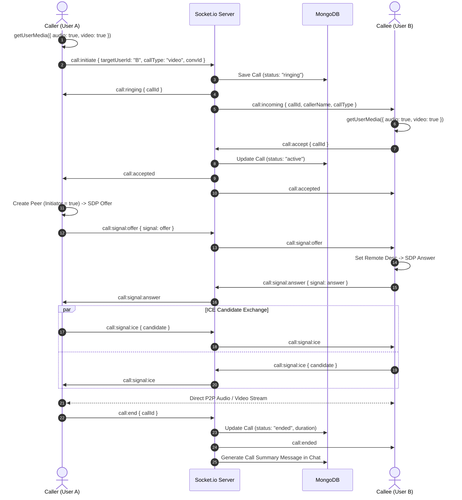

# Real-Time Chat, Audio Calling & Video Calling Blueprint

This artifact provides an architectural reference for implementing **Real-Time Chat**, **1-on-1 Audio Calling**, **Video Calling**, and **Screen Sharing** in a new project, extracted directly from the battle-tested OMS production implementation.

Full code references and step-by-step setup are available in [REALTIME_CHAT_AND_CALLING_IMPLEMENTATION_GUIDE.md](file:///c:/Users/Shubh/Desktop/OMS/docs/REALTIME_CHAT_AND_CALLING_IMPLEMENTATION_GUIDE.md).

---

## 1. Architectural Architecture Matrix

| Layer | Technology | Key Responsibility |
|---|---|---|
| **Signaling Plane** | Socket.io / WebSockets | SDP Offer/Answer exchange, ICE candidate routing, call lifecycle (ring, accept, reject, end) |
| **Media Plane** | WebRTC (SRTP/P2P) | Direct peer-to-peer audio, video, and screen sharing streams (<150ms latency, 0 server bandwidth) |
| **NAT Traversal** | STUN / TURN (coturn) | Public IP discovery (STUN) and symmetric NAT relay fallback (TURN) |
| **Persistence** | MongoDB / PostgreSQL | `calls`, `conversations`, `messages`, call history system summaries |
| **Audio Synthesizer** | Web Audio API | Zero-dependency dialing tone, incoming ringtone, connected, and hangup sounds |
| **Client UI** | React + SimplePeer / React Native | Floating draggable PiP, device switching, screen share toggle, remote audio auto-playback |

---

## 2. Core Call Lifecycle Sequence

---

## 3. Top 5 Implementation Traps & Critical Solutions

1. **Remote Audio Silence**:
   - Web video elements that are muted will suppress audio, and browsers block non-user-initiated audio.
   - **Solution**: Mount a separate `<audio autoPlay>` tag dedicated solely to `remoteStream`, and set `remoteStream.getAudioTracks().forEach(t => t.enabled = true)`.
2. **Missing Media Permissions in Dev**:
   - `navigator.mediaDevices.getUserMedia` is blocked by browsers on plain HTTP unless accessing `localhost`.
   - **Solution**: Run local dev with HTTPS or configure Chrome via `chrome://flags/#unsafely-treat-insecure-origin-as-secure`.
3. **Ghost / Unanswered Calls**:
   - If the callee never responds, callers can be stuck ringing indefinitely.
   - **Solution**: Implement a server-side 45-second timer on `call:initiate` that transitions status to `missed` and notifies both parties.
4. **Offline Devices / Closed Tabs**:
   - WebSocket events do not reach devices when the app is closed.
   - **Solution**: Trigger a high-priority Web Push / FCM / APNs notification in `call:initiate` with type `incoming_call` to wake up the device.
5. **Group Calls (> 2 users)**:
   - P2P Mesh scales quadratically ($O(N^2)$). For 3+ users, transition to an SFU media server like **LiveKit**.
