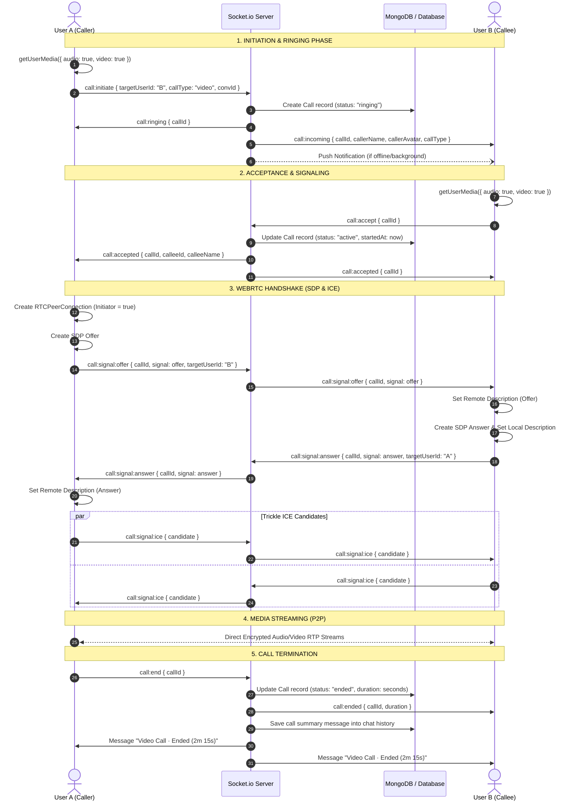

# Complete Implementation Guide: Audio Calling, Video Calling & Real-Time Chat

This documentation provides an end-to-end blueprint and reference implementation for building an enterprise-grade **Real-Time Chat**, **1-on-1 WebRTC Audio Calling**, and **Video Calling** system with **Screen Sharing** in a new project.

---

## 1. System Architecture Overview

```
                      +-----------------------------------+
                      |       Client Applications         |
                      |  (React Web / React Native Mobile)|
                      +-----------------+-----------------+
                                        |
               +------------------------+------------------------+
               | HTTPS (REST API)                                | WSS (Signaling & Chat)
               v                                                 v
    +-----------------------+                         +-----------------------+
    |   Express.js Server   |                         |   Socket.io Server    |
    | - Auth & Profiles     |                         | - Call Signaling      |
    | - Chat History / CRUD |                         | - Real-time Messages  |
    | - Media Upload Sign   |                         | - Presence & Typing   |
    +-----------+-----------+                         +-----------+-----------+
                |                                                 |
                |               +-------------------+             |
                +-------------> |   MongoDB / SQL   | <-----------+
                |               | - Conversations   |
                |               | - Messages        |
                |               | - Call Logs       |
                |               +-------------------+
                |                                                 |
                v                                                 v
    +-----------------------+                         +-----------------------+
    |  Cloud Storage / CDN  |                         |   Redis (Optional)    |
    |  (ImageKit / S3 / GCS)|                         | - Socket Adapter      |
    | - Avatars, Files, Voice|                        | - Presence Cache      |
    +-----------------------+                         +-----------------------+

                        =============================
                        WEBRTC MEDIA PLANE (PEER-TO-PEER)
                        =============================
                                (Direct Audio/Video)
                [ Client A ] <=======================> [ Client B ]
                     ^                                      ^
                     |                                      |
                     +------> [ STUN / TURN Server ] <------+
                               (NAT Traversal & Relay)
```

### Signaling vs. Media Plane
1. **Signaling Plane (Socket.io / WebSocket)**: Used to negotiate the connection.
   - Exchange session metadata (SDP Offer & Answer).
   - Exchange ICE Candidates (network routes, IP addresses, ports).
   - Coordinate call events: initiate, ring, accept, reject, busy, missed, end.
2. **Media Plane (WebRTC P2P)**:
   - Direct audio, video, and screen share RTP streams between browsers/devices via SRTP.
   - The media data **never** touches your backend server in 1-on-1 calls, guaranteeing zero server bandwidth for video streams and ultra-low latency (<150ms).
3. **STUN / TURN Server**:
   - **STUN (Session Traversal Utilities for NAT)**: Discovers the public IP:Port of peers behind routers/firewalls (90% of connections succeed via STUN).
   - **TURN (Traversal Using Relays around NAT)**: Relays encrypted media traffic when direct P2P is blocked by symmetric NATs or corporate firewalls (10% of connections).

---

## 2. WebRTC Call Flow & State Machine



---

## 3. Database Schema & Data Models

### 3.1 Call Model (`call.model.js`)
```javascript
import mongoose from 'mongoose';

const callSchema = new mongoose.Schema({
  id: { type: String, required: true, unique: true, index: true },
  companyId: { type: String, index: true }, // Optional multi-tenant field
  conversationId: { type: String, required: true, index: true },
  
  callerId: { type: String, required: true, index: true },
  callerName: { type: String, required: true },
  callerAvatar: { type: String, default: null },
  
  calleeId: { type: String, required: true, index: true },
  calleeName: { type: String, required: true },
  calleeAvatar: { type: String, default: null },
  
  callType: {
    type: String,
    enum: ['audio', 'video'],
    required: true
  },
  status: {
    type: String,
    enum: ['ringing', 'active', 'rejected', 'ended', 'missed'],
    default: 'ringing'
  },
  startedAt: { type: Date, default: null },
  endedAt: { type: Date, default: null },
  duration: { type: Number, default: 0 } // in seconds
}, {
  timestamps: true,
  collection: 'calls'
});

export default mongoose.model('Call', callSchema);
```

### 3.2 Conversation Model (`conversation.model.js`)
```javascript
import mongoose from 'mongoose';

const participantSchema = new mongoose.Schema({
  userId: { type: String, required: true },
  name: { type: String, required: true },
  avatar: { type: String, default: null },
  role: { type: String, default: 'member' }, // 'admin' | 'member'
  lastReadAt: { type: Date, default: () => new Date() },
  unreadCount: { type: Number, default: 0 },
  joinedAt: { type: Date, default: () => new Date() }
}, { _id: false });

const conversationSchema = new mongoose.Schema({
  id: { type: String, required: true, unique: true, index: true },
  type: {
    type: String,
    enum: ['direct', 'group'],
    required: true
  },
  name: { type: String, default: null }, // Required for group
  avatar: { type: String, default: null },
  description: { type: String, default: '' },
  participants: [participantSchema],
  lastMessage: {
    id: String,
    content: String,
    type: { type: String, default: 'text' },
    senderId: String,
    senderName: String,
    createdAt: Date
  },
  isActive: { type: Boolean, default: true }
}, {
  timestamps: true,
  collection: 'conversations'
});

export default mongoose.model('Conversation', conversationSchema);
```

### 3.3 Message Model (`message.model.js`)
```javascript
import mongoose from 'mongoose';

const reactionSchema = new mongoose.Schema({
  emoji: { type: String, required: true },
  userId: { type: String, required: true },
  name: { type: String, required: true },
  createdAt: { type: Date, default: Date.now }
}, { _id: false });

const attachmentSchema = new mongoose.Schema({
  fileUrl: { type: String, required: true },
  fileType: { type: String, required: true }, // 'image', 'video', 'pdf', etc.
  fileName: { type: String, required: true },
  fileSize: { type: Number, required: true },
  thumbnailUrl: { type: String, default: null }
}, { _id: false });

const messageSchema = new mongoose.Schema({
  id: { type: String, required: true, unique: true, index: true },
  conversationId: { type: String, required: true, index: true },
  senderId: { type: String, required: true, index: true },
  senderName: { type: String, required: true },
  senderAvatar: { type: String, default: null },
  content: { type: String, default: '' },
  type: {
    type: String,
    enum: ['text', 'image', 'video', 'audio', 'document', 'call', 'system'],
    default: 'text'
  },
  attachments: [attachmentSchema],
  replyTo: {
    id: String,
    content: String,
    senderName: String,
    type: String
  },
  reactions: [reactionSchema],
  readBy: [{
    userId: String,
    readAt: { type: Date, default: Date.now }
  }],
  status: {
    type: String,
    enum: ['sending', 'sent', 'delivered', 'read'],
    default: 'sent'
  },
  isPinned: { type: Boolean, default: false },
  isStarred: { type: Boolean, default: false },
  isEdited: { type: Boolean, default: false },
  isDeleted: { type: Boolean, default: false }
}, {
  timestamps: true,
  collection: 'messages'
});

export default mongoose.model('Message', messageSchema);
```

---

## 4. Backend Implementation (Node.js + Socket.io)

### 4.1 Server Bootstrap (`server.js`)
```javascript
import express from 'express';
import http from 'http';
import { Server } from 'socket.io';
import cors from 'cors';
import mongoose from 'mongoose';
import { registerChatSocketHandlers } from './chat.socket.js';

const app = express();
app.use(cors());
app.use(express.json());

const server = http.createServer(app);
const io = new Server(server, {
  cors: {
    origin: '*',
    methods: ['GET', 'POST']
  },
  pingTimeout: 60000,
  pingInterval: 25000
});

// Authenticate socket connections with JWT
io.use(async (socket, next) => {
  try {
    const token = socket.handshake.auth?.token || socket.handshake.headers?.authorization?.split(' ')[1];
    if (!token) return next(new Error('Authentication token missing'));
    
    // Verify JWT and attach user profile to socket
    const decoded = verifyJwt(token); 
    socket.user = decoded; // { id, name, avatar, role }
    next();
  } catch (err) {
    next(new Error('Authentication error'));
  }
});

registerChatSocketHandlers(io);

server.listen(5000, () => console.log('Server running on port 5000'));
```

### 4.2 Complete Socket Calling & Chat Handlers (`chat.socket.js`)
```javascript
import Call from './call.model.js';
import Conversation from './conversation.model.js';
import Message from './message.model.js';
import { v4 as uuidv4 } from 'uuid';

const socketActiveCalls = new Map(); // socketId -> { callId, targetUserId }

export const registerChatSocketHandlers = (io) => {
  io.on('connection', (socket) => {
    const { id: userId, name, avatar } = socket.user;

    // Join personal room for 1-to-1 notifications & calls
    socket.join(`user:${userId}`);

    // Join active conversation rooms
    socket.on('join_conversation', (conversationId) => {
      socket.join(`conv:${conversationId}`);
    });

    // ─── 1. REAL-TIME CHAT MESSAGES ──────────────────────────────────────────
    socket.on('send_message', async (data) => {
      const { conversationId, content, type = 'text', attachments = [], replyTo = null } = data;
      const messageId = uuidv4();

      const newMsg = await Message.create({
        id: messageId,
        conversationId,
        senderId: userId,
        senderName: name,
        senderAvatar: avatar,
        content,
        type,
        attachments,
        replyTo,
        status: 'sent'
      });

      // Update lastMessage on conversation
      await Conversation.findOneAndUpdate(
        { id: conversationId },
        {
          lastMessage: {
            id: messageId,
            content: type === 'text' ? content : `[${type}]`,
            type,
            senderId: userId,
            senderName: name,
            createdAt: new Date()
          }
        }
      );

      // Broadcast to room
      io.to(`conv:${conversationId}`).emit('new_message', newMsg);
    });

    // ─── 2. TYPING INDICATORS ────────────────────────────────────────────────
    socket.on('typing:start', ({ conversationId }) => {
      socket.to(`conv:${conversationId}`).emit('user_typing', { userId, name, conversationId });
    });

    socket.on('typing:stop', ({ conversationId }) => {
      socket.to(`conv:${conversationId}`).emit('user_stopped_typing', { userId, conversationId });
    });

    // ─── 3. WEBRTC CALL INITIATION ───────────────────────────────────────────
    socket.on('call:initiate', async ({ targetUserId, callType, conversationId }) => {
      try {
        const callId = uuidv4();

        const callRecord = await Call.create({
          id: callId,
          conversationId,
          callerId: userId,
          callerName: name,
          callerAvatar: avatar,
          calleeId: targetUserId,
          calleeName: 'User', // Populate from DB query in production
          calleeAvatar: null,
          callType,
          status: 'ringing'
        });

        socketActiveCalls.set(socket.id, { callId, targetUserId });
        socket.emit('call:ringing', { callId, callType });

        // Notify Callee via socket
        io.to(`user:${targetUserId}`).emit('call:incoming', {
          callId,
          callerId: userId,
          callerName: name,
          callerAvatar: avatar,
          callType,
          conversationId
        });

        // 45s Ringing Timeout (Missed Call auto-trigger)
        const ringingTimeout = setTimeout(async () => {
          const currentCall = await Call.findOne({ id: callId, status: 'ringing' });
          if (currentCall) {
            currentCall.status = 'missed';
            await currentCall.save();

            io.to(`user:${userId}`).emit('call:missed', { callId, reason: 'no_answer' });
            io.to(`user:${targetUserId}`).emit('call:missed', { callId, reason: 'no_answer' });

            socketActiveCalls.delete(socket.id);
            await createCallHistoryMessage(currentCall, io);
          }
        }, 45000);

        socket.ringingTimeout = ringingTimeout;
      } catch (err) {
        socket.emit('call:error', { message: 'Failed to initiate call' });
      }
    });

    // ─── 4. ACCEPT CALL ──────────────────────────────────────────────────────
    socket.on('call:accept', async ({ callId }) => {
      if (socket.ringingTimeout) clearTimeout(socket.ringingTimeout);

      const callRecord = await Call.findOneAndUpdate(
        { id: callId, status: 'ringing' },
        { status: 'active', startedAt: new Date() },
        { new: true }
      );
      if (!callRecord) return;

      socketActiveCalls.set(socket.id, { callId, targetUserId: callRecord.callerId });

      const payload = { callId, calleeId: userId, calleeName: name, calleeAvatar: avatar };
      io.to(`user:${callRecord.callerId}`).emit('call:accepted', payload);
      io.to(`user:${callRecord.calleeId}`).emit('call:accepted', payload);
    });

    // ─── 5. REJECT CALL ──────────────────────────────────────────────────────
    socket.on('call:reject', async ({ callId, reason = 'declined' }) => {
      if (socket.ringingTimeout) clearTimeout(socket.ringingTimeout);

      const callRecord = await Call.findOneAndUpdate(
        { id: callId, status: 'ringing' },
        { status: 'rejected', endedAt: new Date() },
        { new: true }
      );
      if (!callRecord) return;

      io.to(`user:${callRecord.callerId}`).emit('call:rejected', { callId, reason, calleeName: name });
      io.to(`user:${callRecord.calleeId}`).emit('call:rejected', { callId, reason });

      socketActiveCalls.delete(socket.id);
      await createCallHistoryMessage(callRecord, io);
    });

    // ─── 6. END CALL ─────────────────────────────────────────────────────────
    socket.on('call:end', async ({ callId }) => {
      if (socket.ringingTimeout) clearTimeout(socket.ringingTimeout);

      const callRecord = await Call.findOne({ id: callId });
      if (!callRecord) return;

      const otherPartyId = callRecord.callerId === userId ? callRecord.calleeId : callRecord.callerId;

      if (callRecord.status === 'ringing') {
        callRecord.status = 'missed';
        callRecord.endedAt = new Date();
        await callRecord.save();
        io.to(`user:${otherPartyId}`).emit('call:missed', { callId, reason: 'cancelled' });
      } else if (callRecord.status === 'active') {
        const endedAt = new Date();
        const duration = Math.round((endedAt - (callRecord.startedAt || callRecord.createdAt)) / 1000);
        callRecord.status = 'ended';
        callRecord.endedAt = endedAt;
        callRecord.duration = duration;
        await callRecord.save();

        io.to(`user:${otherPartyId}`).emit('call:ended', { callId, duration, endedBy: userId });
      }

      socketActiveCalls.delete(socket.id);
      await createCallHistoryMessage(callRecord, io);
    });

    // ─── 7. WEBRTC SIGNAL PASS-THROUGH (SDP Offer, Answer, ICE) ──────────────
    socket.on('call:signal:offer', ({ callId, signal, targetUserId }) => {
      io.to(`user:${targetUserId}`).emit('call:signal:offer', { callId, signal, senderId: userId });
    });

    socket.on('call:signal:answer', ({ callId, signal, targetUserId }) => {
      io.to(`user:${targetUserId}`).emit('call:signal:answer', { callId, signal, senderId: userId });
    });

    socket.on('call:signal:ice', ({ callId, candidate, targetUserId }) => {
      io.to(`user:${targetUserId}`).emit('call:signal:ice', { callId, candidate, senderId: userId });
    });

    // ─── 8. DISCONNECT CLEANUP ───────────────────────────────────────────────
    socket.on('disconnect', async () => {
      const activeCall = socketActiveCalls.get(socket.id);
      if (activeCall) {
        const { callId, targetUserId } = activeCall;
        const callRecord = await Call.findOne({ id: callId });
        if (callRecord && (callRecord.status === 'ringing' || callRecord.status === 'active')) {
          const status = callRecord.status === 'ringing' ? 'missed' : 'ended';
          const duration = status === 'ended' ? Math.round((Date.now() - callRecord.startedAt) / 1000) : 0;
          callRecord.status = status;
          callRecord.endedAt = new Date();
          callRecord.duration = duration;
          await callRecord.save();

          io.to(`user:${targetUserId}`).emit(status === 'ended' ? 'call:ended' : 'call:missed', {
            callId, duration, endedBy: userId
          });
          await createCallHistoryMessage(callRecord, io);
        }
        socketActiveCalls.delete(socket.id);
      }
    });
  });
};

// Helper: Auto-generates system chat message for call status
async function createCallHistoryMessage(callRecord, io) {
  const isVideo = callRecord.callType === 'video';
  let statusText = '';

  if (callRecord.status === 'ended') {
    const min = Math.floor(callRecord.duration / 60);
    const sec = callRecord.duration % 60;
    const dur = min > 0 ? `${min}m ${sec}s` : `${sec}s`;
    statusText = `${isVideo ? 'Video' : 'Voice'} Call · Ended (${dur})`;
  } else if (callRecord.status === 'rejected') {
    statusText = `${isVideo ? 'Video' : 'Voice'} Call · Declined`;
  } else if (callRecord.status === 'missed') {
    statusText = `Missed ${isVideo ? 'Video' : 'Voice'} Call`;
  } else {
    return;
  }

  const msg = await Message.create({
    id: uuidv4(),
    conversationId: callRecord.conversationId,
    senderId: callRecord.callerId,
    senderName: callRecord.callerName,
    senderAvatar: callRecord.callerAvatar,
    content: statusText,
    type: 'call'
  });

  io.to(`conv:${callRecord.conversationId}`).emit('new_message', msg);
}
```

---

## 5. Web Client Implementation (React + Vite)

### 5.1 STUN/TURN Configurations & WebRTC Hook (`useWebRTC.js`)
Install dependency:
```bash
npm install simple-peer
```

```javascript
import { useRef, useState, useCallback, useEffect } from 'react';
import SimplePeer from 'simple-peer/simplepeer.min.js';

export const ICE_SERVERS = {
  iceServers: [
    { urls: 'stun:stun.l.google.com:19302' },
    { urls: 'stun:stun1.l.google.com:19302' },
    // Include TURN servers here for production relay fallback
    // {
    //   urls: 'turn:turn.yourdomain.com:3478',
    //   username: 'user',
    //   credential: 'password'
    // }
  ]
};

export const useWebRTC = (socket) => {
  const [localStream, setLocalStream] = useState(null);
  const [remoteStream, setRemoteStream] = useState(null);
  const [isMuted, setIsMuted] = useState(false);
  const [isVideoOff, setIsVideoOff] = useState(false);
  const [isScreenSharing, setIsScreenSharing] = useState(false);
  const [isFrontCamera, setIsFrontCamera] = useState(true);
  const [callDuration, setCallDuration] = useState(0);
  const [connectionState, setConnectionState] = useState('idle'); // idle | connecting | connected | failed

  const peerRef = useRef(null);
  const localStreamRef = useRef(null);
  const screenStreamRef = useRef(null);
  const cameraTrackRef = useRef(null);
  const durationTimerRef = useRef(null);
  const callIdRef = useRef(null);
  const targetUserIdRef = useRef(null);

  // 1. Acquire Media Stream (Microphone / Camera)
  const getMedia = useCallback(async (callType) => {
    try {
      const stream = await navigator.mediaDevices.getUserMedia({
        audio: {
          echoCancellation: true,
          noiseSuppression: true,
          autoGainControl: true
        },
        video: callType === 'video'
          ? { width: { ideal: 1280 }, height: { ideal: 720 }, facingMode: 'user' }
          : false
      });
      localStreamRef.current = stream;
      setLocalStream(stream);
      return stream;
    } catch (err) {
      if (callType === 'video') {
        // Fallback to audio-only if camera is unavailable/denied
        const audioStream = await navigator.mediaDevices.getUserMedia({ audio: true, video: false });
        localStreamRef.current = audioStream;
        setLocalStream(audioStream);
        return audioStream;
      }
      throw err;
    }
  }, []);

  // 2. Initialize SimplePeer Instance
  const createPeer = useCallback((initiator, stream, callId, targetUserId) => {
    callIdRef.current = callId;
    targetUserIdRef.current = targetUserId;
    setConnectionState('connecting');

    const peer = new SimplePeer({
      initiator,
      stream,
      trickle: true,
      config: ICE_SERVERS
    });

    // Signaling event fired by simple-peer
    peer.on('signal', (signal) => {
      if (signal.type === 'offer') {
        socket.emit('call:signal:offer', { callId, signal, targetUserId });
      } else if (signal.type === 'answer') {
        socket.emit('call:signal:answer', { callId, signal, targetUserId });
      } else if (signal.candidate) {
        socket.emit('call:signal:ice', { callId, candidate: signal, targetUserId });
      }
    });

    // Remote stream received
    peer.on('stream', (rStream) => {
      rStream.getAudioTracks().forEach(t => { t.enabled = true; });
      setRemoteStream(rStream);
      setConnectionState('connected');

      // Start duration counter
      clearInterval(durationTimerRef.current);
      durationTimerRef.current = setInterval(() => {
        setCallDuration(prev => prev + 1);
      }, 1000);
    });

    peer.on('error', () => {
      setConnectionState('failed');
    });

    peer.on('close', () => {
      setConnectionState('idle');
      clearInterval(durationTimerRef.current);
    });

    peerRef.current = peer;
    return peer;
  }, [socket]);

  // 3. Receive Remote Signal
  const handleSignal = useCallback((signal) => {
    if (peerRef.current && !peerRef.current.destroyed) {
      peerRef.current.signal(signal);
    }
  }, []);

  // 4. Media Controls
  const toggleMute = useCallback(() => {
    if (!localStreamRef.current) return;
    localStreamRef.current.getAudioTracks().forEach(track => {
      track.enabled = !track.enabled;
    });
    setIsMuted(prev => !prev);
  }, []);

  const toggleVideo = useCallback(() => {
    if (!localStreamRef.current) return;
    localStreamRef.current.getVideoTracks().forEach(track => {
      track.enabled = !track.enabled;
    });
    setIsVideoOff(prev => !prev);
  }, []);

  // 5. Screen Share with Audio
  const toggleScreenShare = useCallback(async () => {
    if (isScreenSharing) {
      // Stop screen sharing and restore camera
      screenStreamRef.current?.getTracks().forEach(t => t.stop());
      const screenTrack = localStreamRef.current?.getVideoTracks()[0];

      if (cameraTrackRef.current) {
        if (screenTrack) localStreamRef.current.removeTrack(screenTrack);
        localStreamRef.current.addTrack(cameraTrackRef.current);

        if (peerRef.current && !peerRef.current.destroyed) {
          peerRef.current.replaceTrack(screenTrack, cameraTrackRef.current, localStreamRef.current);
        }
      }
      cameraTrackRef.current = null;
      setLocalStream(new MediaStream(localStreamRef.current.getTracks()));
      setIsScreenSharing(false);
    } else {
      try {
        const screenStream = await navigator.mediaDevices.getDisplayMedia({ video: true, audio: true });
        screenStreamRef.current = screenStream;
        const screenTrack = screenStream.getVideoTracks()[0];
        const existingCameraTrack = localStreamRef.current?.getVideoTracks()[0];

        if (existingCameraTrack) {
          cameraTrackRef.current = existingCameraTrack;
          localStreamRef.current.removeTrack(existingCameraTrack);
          localStreamRef.current.addTrack(screenTrack);

          if (peerRef.current && !peerRef.current.destroyed) {
            peerRef.current.replaceTrack(existingCameraTrack, screenTrack, localStreamRef.current);
          }
        }
        setLocalStream(new MediaStream(localStreamRef.current.getTracks()));

        screenTrack.onended = () => toggleScreenShare();
        setIsScreenSharing(true);
      } catch (err) {
        console.error('Screen sharing error:', err);
      }
    }
  }, [isScreenSharing]);

  // 6. Cleanup
  const cleanup = useCallback(() => {
    clearInterval(durationTimerRef.current);
    if (peerRef.current && !peerRef.current.destroyed) {
      peerRef.current.destroy();
    }
    localStreamRef.current?.getTracks().forEach(t => t.stop());
    screenStreamRef.current?.getTracks().forEach(t => t.stop());

    peerRef.current = null;
    localStreamRef.current = null;
    screenStreamRef.current = null;
    cameraTrackRef.current = null;

    setLocalStream(null);
    setRemoteStream(null);
    setIsMuted(false);
    setIsVideoOff(false);
    setIsScreenSharing(false);
    setCallDuration(0);
    setConnectionState('idle');
  }, []);

  return {
    localStream,
    remoteStream,
    isMuted,
    isVideoOff,
    isScreenSharing,
    isFrontCamera,
    callDuration,
    connectionState,
    getMedia,
    createPeer,
    handleSignal,
    toggleMute,
    toggleVideo,
    toggleScreenShare,
    cleanup
  };
};
```

---

### 5.2 Synthesized Call Audio (Dialtone & Ringtone via Web Audio API)
*No external `.mp3` files needed! Creates authentic telecom ring tones via browser oscillators.*

```javascript
// callSounds.js
class CallSoundSynthesizer {
  constructor() {
    this.ctx = null;
    this.timer = null;
  }

  init() {
    if (!this.ctx) {
      const AudioCtx = window.AudioContext || window.webkitAudioContext;
      this.ctx = new AudioCtx();
    }
    if (this.ctx.state === 'suspended') {
      this.ctx.resume();
    }
  }

  // Outgoing Ring: US Tone (440Hz + 480Hz dual tone, 2s on, 4s off)
  startOutgoingRing() {
    this.stopAll();
    this.init();
    const playTone = () => {
      const osc1 = this.ctx.createOscillator();
      const osc2 = this.ctx.createOscillator();
      const gain = this.ctx.createGain();

      osc1.frequency.value = 440;
      osc2.frequency.value = 480;
      gain.gain.setValueAtTime(0.08, this.ctx.currentTime);
      gain.gain.exponentialRampToValueAtTime(0.001, this.ctx.currentTime + 2.0);

      osc1.connect(gain);
      osc2.connect(gain);
      gain.connect(this.ctx.destination);

      osc1.start();
      osc2.start();
      osc1.stop(this.ctx.currentTime + 2.0);
      osc2.stop(this.ctx.currentTime + 2.0);
    };

    playTone();
    this.timer = setInterval(playTone, 4000);
  }

  // Incoming Call: Modern melodic chime
  startIncomingRing() {
    this.stopAll();
    this.init();
    const playChime = () => {
      [523.25, 659.25, 783.99, 1046.5].forEach((freq, i) => {
        const osc = this.ctx.createOscillator();
        const gain = this.ctx.createGain();
        osc.frequency.value = freq;
        gain.gain.setValueAtTime(0.12, this.ctx.currentTime + i * 0.15);
        gain.gain.exponentialRampToValueAtTime(0.001, this.ctx.currentTime + i * 0.15 + 0.4);

        osc.connect(gain);
        gain.connect(this.ctx.destination);
        osc.start(this.ctx.currentTime + i * 0.15);
        osc.stop(this.ctx.currentTime + i * 0.15 + 0.4);
      });
    };

    playChime();
    this.timer = setInterval(playChime, 2500);
  }

  stopAll() {
    if (this.timer) {
      clearInterval(this.timer);
      this.timer = null;
    }
  }
}

export const callSounds = new CallSoundSynthesizer();
```

---

### 5.3 Global Call Context (`CallContext.jsx`)
```javascript
import React, { createContext, useContext, useState, useEffect, useRef, useCallback } from 'react';
import { useWebRTC } from './useWebRTC';
import { callSounds } from './callSounds';

const CallContext = createContext(null);

export const CallProvider = ({ children, socket, currentUser }) => {
  const [callState, setCallState] = useState('idle'); // idle | outgoing | incoming | active
  const [callInfo, setCallInfo] = useState(null);

  const webrtc = useWebRTC(socket);

  // 1. Initiate Outgoing Call
  const initiateCall = useCallback(async (targetUser, callType, conversationId) => {
    try {
      const stream = await webrtc.getMedia(callType);
      setCallInfo({
        callType,
        conversationId,
        callerId: currentUser.id,
        calleeId: targetUser.id,
        calleeName: targetUser.name,
        calleeAvatar: targetUser.avatar
      });
      setCallState('outgoing');
      callSounds.startOutgoingRing();

      socket.emit('call:initiate', {
        targetUserId: targetUser.id,
        callType,
        conversationId
      });
    } catch (err) {
      alert(err.message);
      webrtc.cleanup();
      setCallState('idle');
    }
  }, [socket, currentUser, webrtc]);

  // 2. Accept Incoming Call
  const acceptCall = useCallback(async () => {
    try {
      callSounds.stopAll();
      const stream = await webrtc.getMedia(callInfo.callType);
      socket.emit('call:accept', { callId: callInfo.callId });

      // Callee is NOT the initiator (initiator = false)
      webrtc.createPeer(false, stream, callInfo.callId, callInfo.callerId);
      setCallState('active');
    } catch (err) {
      rejectCall('media_error');
    }
  }, [socket, callInfo, webrtc]);

  // 3. Reject Call
  const rejectCall = useCallback((reason = 'declined') => {
    callSounds.stopAll();
    if (callInfo?.callId) {
      socket.emit('call:reject', { callId: callInfo.callId, reason });
    }
    webrtc.cleanup();
    setCallState('idle');
    setCallInfo(null);
  }, [socket, callInfo, webrtc]);

  // 4. End Active Call
  const endCall = useCallback(() => {
    callSounds.stopAll();
    if (callInfo?.callId) {
      socket.emit('call:end', { callId: callInfo.callId });
    }
    webrtc.cleanup();
    setCallState('idle');
    setCallInfo(null);
  }, [socket, callInfo, webrtc]);

  // 5. Socket Listeners for Signaling
  useEffect(() => {
    if (!socket) return;

    socket.on('call:ringing', ({ callId }) => {
      setCallInfo(prev => ({ ...prev, callId }));
    });

    socket.on('call:incoming', (data) => {
      if (callState !== 'idle') {
        socket.emit('call:reject', { callId: data.callId, reason: 'busy' });
        return;
      }
      setCallInfo(data);
      setCallState('incoming');
      callSounds.startIncomingRing();
    });

    socket.on('call:accepted', ({ callId, calleeId, calleeName }) => {
      callSounds.stopAll();
      setCallState('active');

      // Caller IS the initiator (initiator = true)
      if (currentUser.id === callInfo?.callerId) {
        webrtc.createPeer(true, webrtc.localStream, callId, calleeId);
      }
    });

    socket.on('call:rejected', () => {
      callSounds.stopAll();
      webrtc.cleanup();
      setCallState('idle');
      setCallInfo(null);
    });

    socket.on('call:ended', () => {
      callSounds.stopAll();
      webrtc.cleanup();
      setCallState('idle');
      setCallInfo(null);
    });

    socket.on('call:missed', () => {
      callSounds.stopAll();
      webrtc.cleanup();
      setCallState('idle');
      setCallInfo(null);
    });

    socket.on('call:signal:offer', ({ signal }) => webrtc.handleSignal(signal));
    socket.on('call:signal:answer', ({ signal }) => webrtc.handleSignal(signal));
    socket.on('call:signal:ice', ({ candidate }) => webrtc.handleSignal(candidate));

    return () => {
      socket.off('call:ringing');
      socket.off('call:incoming');
      socket.off('call:accepted');
      socket.off('call:rejected');
      socket.off('call:ended');
      socket.off('call:missed');
      socket.off('call:signal:offer');
      socket.off('call:signal:answer');
      socket.off('call:signal:ice');
    };
  }, [socket, callState, callInfo, currentUser, webrtc]);

  return (
    <CallContext.Provider value={{
      callState,
      callInfo,
      ...webrtc,
      initiateCall,
      acceptCall,
      rejectCall,
      endCall
    }}>
      {children}
    </CallContext.Provider>
  );
};

export const useCall = () => useContext(CallContext);
```

---

### 5.4 Call Screen Component with Video PiP (`CallScreen.jsx`)
*Includes the critical audio output element and video stream rendering.*

```jsx
import React, { useRef, useEffect } from 'react';
import { useCall } from './CallContext';

export const CallScreen = () => {
  const {
    callState,
    callInfo,
    localStream,
    remoteStream,
    isMuted,
    isVideoOff,
    isScreenSharing,
    callDuration,
    acceptCall,
    rejectCall,
    endCall,
    toggleMute,
    toggleVideo,
    toggleScreenShare
  } = useCall();

  const mainVideoRef = useRef(null);
  const pipVideoRef = useRef(null);
  const remoteAudioRef = useRef(null);

  // Attach local and remote streams to video tags
  useEffect(() => {
    if (mainVideoRef.current && remoteStream) {
      mainVideoRef.current.srcObject = remoteStream;
    }
  }, [remoteStream]);

  useEffect(() => {
    if (pipVideoRef.current && localStream) {
      pipVideoRef.current.srcObject = localStream;
    }
  }, [localStream]);

  // CRITICAL: Attach remote stream to audio element for crisp audio playback
  useEffect(() => {
    if (remoteAudioRef.current && remoteStream) {
      remoteAudioRef.current.srcObject = remoteStream;
      remoteAudioRef.current.play().catch(e => console.warn('Audio auto-play blocked', e));
    }
  }, [remoteStream]);

  if (callState === 'idle') return null;

  // 1. INCOMING CALL MODAL
  if (callState === 'incoming') {
    return (
      <div style={overlayStyle}>
        <div style={modalCardStyle}>
          
          <h2>{callInfo?.callerName}</h2>
          <p>Incoming {callInfo?.callType} call...</p>
          <div style={{ display: 'flex', gap: '24px', marginTop: '24px' }}>
            <button onClick={() => rejectCall('declined')} style={declineBtnStyle}>Decline</button>
            <button onClick={acceptCall} style={acceptBtnStyle}>Accept</button>
          </div>
        </div>
      </div>
    );
  }

  // 2. ACTIVE / OUTGOING CALL VIEW
  const isVideo = callInfo?.callType === 'video';

  return (
    <div style={callContainerStyle}>
      {/* Remote Audio Element (Hidden) */}
      <audio ref={remoteAudioRef} autoPlay style={{ display: 'none' }} />

      {/* Main Screen (Remote Video or Audio Avatar) */}
      {isVideo && remoteStream && remoteStream.getVideoTracks().length > 0 ? (
        <video ref={mainVideoRef} autoPlay playsInline style={fullScreenVideoStyle} />
      ) : (
        <div style={audioFallbackStyle}>
          
          <h2>{callInfo?.calleeName}</h2>
          <p>{callState === 'outgoing' ? 'Calling...' : `Call active · ${formatSeconds(callDuration)}`}</p>
        </div>
      )}

      {/* Picture-in-Picture (PiP) Local Video */}
      {isVideo && localStream && !isVideoOff && (
        <div style={pipContainerStyle}>
          <video ref={pipVideoRef} autoPlay playsInline muted style={pipVideoStyle} />
        </div>
      )}

      {/* Call Toolbar Controls */}
      <div style={controlsBarStyle}>
        <button onClick={toggleMute} style={controlBtnStyle(isMuted)}>
          {isMuted ? 'Unmute' : 'Mute'}
        </button>

        {isVideo && (
          <>
            <button onClick={toggleVideo} style={controlBtnStyle(isVideoOff)}>
              {isVideoOff ? 'Start Video' : 'Stop Video'}
            </button>
            <button onClick={toggleScreenShare} style={controlBtnStyle(isScreenSharing)}>
              {isScreenSharing ? 'Stop Share' : 'Share Screen'}
            </button>
          </>
        )}

        <button onClick={endCall} style={hangupBtnStyle}>End Call</button>
      </div>
    </div>
  );
};

const formatSeconds = (sec) => `${Math.floor(sec / 60)}:${(sec % 60).toString().padStart(2, '0')}`;

// Styling tokens
const overlayStyle = { position: 'fixed', inset: 0, background: 'rgba(0,0,0,0.85)', display: 'flex', alignItems: 'center', justifyContent: 'center', zIndex: 9999 };
const modalCardStyle = { background: '#18181b', color: '#fff', borderRadius: '16px', padding: '32px', textAlign: 'center', minWidth: '320px' };
const avatarLargeStyle = { width: '96px', height: '96px', borderRadius: '50%', objectFit: 'cover', margin: '0 auto 16px' };
const acceptBtnStyle = { background: '#10b981', color: '#fff', border: 'none', padding: '12px 28px', borderRadius: '9999px', fontSize: '16px', cursor: 'pointer' };
const declineBtnStyle = { background: '#ef4444', color: '#fff', border: 'none', padding: '12px 28px', borderRadius: '9999px', fontSize: '16px', cursor: 'pointer' };
const callContainerStyle = { position: 'fixed', inset: 0, background: '#09090b', zIndex: 9999, display: 'flex', flexDirection: 'column' };
const fullScreenVideoStyle = { width: '100%', height: '100%', objectFit: 'cover' };
const audioFallbackStyle = { flex: 1, display: 'flex', flexDirection: 'column', alignItems: 'center', justifyContent: 'center', color: '#fff' };
const pipContainerStyle = { position: 'absolute', top: '24px', right: '24px', width: '200px', height: '130px', borderRadius: '12px', overflow: 'hidden', boxShadow: '0 8px 24px rgba(0,0,0,0.5)', border: '2px solid rgba(255,255,255,0.2)' };
const pipVideoStyle = { width: '100%', height: '100%', objectFit: 'cover', transform: 'scaleX(-1)' };
const controlsBarStyle = { position: 'absolute', bottom: '32px', left: '50%', transform: 'translateX(-50%)', display: 'flex', gap: '16px', background: 'rgba(24,24,27,0.85)', backdropFilter: 'blur(12px)', padding: '12px 24px', borderRadius: '9999px' };
const controlBtnStyle = (active) => ({ background: active ? '#ef4444' : 'rgba(255,255,255,0.15)', color: '#fff', border: 'none', padding: '10px 20px', borderRadius: '9999px', cursor: 'pointer' });
const hangupBtnStyle = { background: '#dc2626', color: '#fff', border: 'none', padding: '10px 24px', borderRadius: '9999px', cursor: 'pointer', fontWeight: 600 };
```

---

## 6. Mobile Client Implementation (React Native / Expo)

For mobile apps, standard browser `navigator.mediaDevices` is not present. Use `react-native-webrtc`.

### 6.1 Installation
```bash
# Bare React Native
npm install react-native-webrtc

# Expo (Development Client / Prebuild required)
npx expo install react-native-webrtc
```

### 6.2 Mobile WebRTC Hook (`useMobileWebRTC.ts`)
```typescript
import { useState, useRef, useCallback, useEffect } from 'react';
import {
  RTCPeerConnection,
  RTCIceCandidate,
  RTCSessionDescription,
  mediaDevices,
  MediaStream
} from 'react-native-webrtc';
import { Socket } from 'socket.io-client';

const ICE_SERVERS = {
  iceServers: [{ urls: 'stun:stun.l.google.com:19302' }]
};

export const useMobileWebRTC = (socket: Socket) => {
  const [localStream, setLocalStream] = useState<MediaStream | null>(null);
  const [remoteStream, setRemoteStream] = useState<MediaStream | null>(null);
  const [isMuted, setIsMuted] = useState(false);
  const [isVideoOff, setIsVideoOff] = useState(false);
  const pcRef = useRef<RTCPeerConnection | null>(null);

  // 1. Get Mobile Camera/Mic
  const getMediaStream = async (isVideo: boolean) => {
    const stream = await mediaDevices.getUserMedia({
      audio: true,
      video: isVideo ? { facingMode: 'user', frameRate: 30 } : false
    });
    setLocalStream(stream);
    return stream;
  };

  // 2. Setup Peer Connection
  const createPeerConnection = (isInitiator: boolean, stream: MediaStream, callId: string, targetUserId: string) => {
    const pc = new RTCPeerConnection(ICE_SERVERS);

    stream.getTracks().forEach((track) => pc.addTrack(track, stream));

    pc.onicecandidate = (event) => {
      if (event.candidate) {
        socket.emit('call:signal:ice', { callId, candidate: event.candidate, targetUserId });
      }
    };

    pc.ontrack = (event) => {
      if (event.streams && event.streams[0]) {
        setRemoteStream(event.streams[0]);
      }
    };

    pcRef.current = pc;
    return pc;
  };

  // 3. Flip Camera (Mobile specific)
  const flipCamera = () => {
    if (localStream) {
      localStream.getVideoTracks().forEach((track: any) => {
        if (typeof track._switchCamera === 'function') {
          track._switchCamera();
        }
      });
    }
  };

  return { localStream, remoteStream, isMuted, isVideoOff, getMediaStream, createPeerConnection, flipCamera };
};
```

---

## 7. Troubleshooting & Production Gotchas

### 1. The "No Audio on Remote Stream" Bug
- **Cause**: Chrome & modern browsers block audio playback unless explicitly interacted with, or `<video muted>` also mutes audio tracks.
- **Fix**: Mount a dedicated `<audio autoPlay>` tag in React specifically for `remoteStream`, and set `videoElement.muted = true` on the video tags. Ensure `remoteStream.getAudioTracks().forEach(t => t.enabled = true)`.

### 2. HTTPS / Secure Context Requirement
- `getUserMedia` **fails immediately** on plain `http://` unless it is `http://localhost`.
- When testing on your mobile phone or LAN IP (`http://192.168.x.x:5173`), Chrome will deny mic/camera permissions.
- **Fix**: Use ngrok, local SSL certificates via `vite-plugin-basic-ssl`, or set `chrome://flags/#unsafely-treat-insecure-origin-as-secure`.

### 3. Symmetric NAT & Firewall Traversal
- If users can connect on the same WiFi but fail on mobile 4G/5G data, P2P direct hole punching failed.
- **Fix**: Install and configure **coturn** on a public VPS (Ubuntu $5 droplet) with open UDP ports 3478 and 49152-65535.

### 4. Background Push Notifications for Calls
- If the callee has closed the app or browser tab, WebSocket events will not reach them.
- **Fix**: When `call:initiate` arrives at the server, simultaneously send a high-priority Web Push / FCM / APNs notification with payload `{ type: "incoming_call", callId }`.

### 5. Scaling to Group Calls (> 2 Participants)
- P2P Mesh scales as $O(N^2)$ connections. For 3+ users in a group call, each participant's CPU will overheat and upload bandwidth will choke.
- **Recommendation**: Transition group calling to an SFU (Selective Forwarding Unit) like **LiveKit** where every client sends 1 stream to the server and the server forwards packets.

---

## 8. Implementation Checklist for Your New Project

| # | Step | Key Action |
|---|---|---|
| 1 | **Dependencies** | `npm install express socket.io mongoose simple-peer uuid` |
| 2 | **Database** | Create `Call`, `Conversation`, and `Message` models in MongoDB |
| 3 | **Socket Setup** | Setup `io.use()` JWT auth, join `user:<id>` and `conv:<id>` rooms |
| 4 | **Chat Logic** | Implement `send_message`, `typing:start`, and message history pagination |
| 5 | **Call Signaling** | Implement `call:initiate`, `call:accept`, `call:reject`, `call:end`, and `call:signal:*` |
| 6 | **WebRTC Hook** | Build `useWebRTC.js` handling `getUserMedia`, `SimplePeer`, and media track toggle |
| 7 | **Ringtones** | Integrate `callSounds.js` Web Audio synthesizer for zero-dependency ringers |
| 8 | **UI Component** | Build `CallScreen.jsx` with full-screen video, draggable PiP, and dedicated `<audio>` tag |
| 9 | **Testing** | Open two different browser profiles (e.g. Chrome normal + Chrome Incognito) and test call flow |
